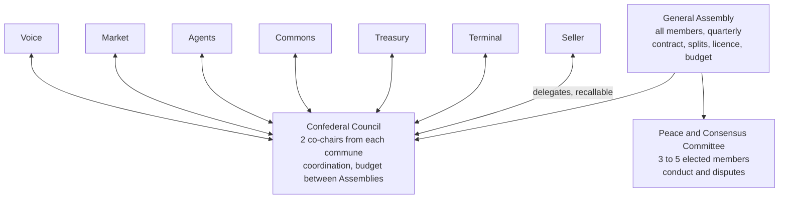

# Governance, day to day

The [Charter](CHARTER.md) is the culture and comes first. The [Social Contract](SOCIAL_CONTRACT.md) is the constitution that protects it. This page is the practical version: who decides what, how to get something decided, and where it gets written down. The Council can change this page by a simple majority, as long as it stays within the Social Contract.

## The shape of it

Arrows to the Council run both ways on purpose: delegates carry their commune's position up and bring decisions back down. The Assembly sits above the Council, but each commune is sovereign within its own scope.

## Which route does my decision take?

1. **Is it inside one commune's scope?** (Its code paths in [COMMUNES.md](COMMUNES.md), its roadmap, its rituals.) Do it. Follow your commune's norms and log anything significant in the commune notes.
2. **Does it touch another commune's code or plans?** Open an issue or PR, tag the affected commune, and use **lazy consensus**: it passes after 72 hours unless someone raises a blocking objection.
3. **Is it cross-cutting, a new product, a policy, or a protocol change?** Write an **RFC** (copy `rfcs/0000-template.md`). Discussion runs at least 7 days. Co-chairs of the affected communes facilitate toward consensus. If it is still blocked, the Council votes.
4. **Does it change money splits, the licence, the legal home, the communes, or the Social Contract?** It goes to the **Assembly**.

When in doubt, go one level up. It costs a few days, not trust.

## Rhythms

| Body | Meets | Notes |
|---|---|---|
| Each commune | At least fortnightly | Public notes in `communes/<name>/notes/` |
| Confederal Council | Fortnightly, 45 minutes | Agenda open to all members; any member may attend and speak |
| General Assembly | Quarterly, plus extraordinary sessions | 7-day async voting window after each session |
| Peace and Consensus Committee | As needed | Proceedings private, outcomes published without names |

An **extraordinary Assembly** is called by the Council, or by any 10 members.

## Votes

- **Where:** a GitHub Discussion in the `votes` category, one comment per member, or a ballot tool the Council chooses. Results are copied into the decision log.
- **Eligibility:** members as listed in `MEMBERS.md` on the day the vote opens.
- **Quorum and thresholds:** see section 5 of the Social Contract.
- **Abstain** if you have a direct commercial interest, and say so.

## The decision log

Every decision above do-ocracy level goes in `decisions/` as a short numbered record: what was decided, by which body, the vote or consensus, and the link to the discussion. Use `decisions/0000-template.md`. The log is the project's memory; if it is not in the log, it was not decided.

## Recall and rotation

- Co-chair terms are 6 months, staggered so communes never replace both co-chairs at once.
- A commune can recall a co-chair at any time by simple majority of its members. The recall takes effect immediately; the commune picks an interim co-chair at the same meeting.
- The Council keeps a public rota of terms in `COMMUNES.md`.

## Money, in practice

- The Treasury commune runs the books and publishes a monthly summary in `treasury/`.
- Spending inside an approved budget line is a Treasury do-ocracy decision up to a limit the Assembly sets (proposed: £1,000 per item).
- Spending above that, or outside a budget line, needs a Council vote.
- Revenue splits change only by Assembly vote.
- At each month end the Treasury works out profit (the network's 30% minus actual costs), moves 10% of it to the fighting fund, and splits the rest between the beer and marketing pots in the ratio the Assembly set.
- **Beer pot:** spent by the Council on gatherings, preferably in person, preferably near a pub. Receipts go in the monthly summary.
- **Marketing pot:** the Voice commune proposes, the Council approves anything above the do-ocracy limit.
- **Fighting fund requests** never go in public issues or channels. Members email the fund panel privately (address set at the Founding Assembly). See section 7 of the Social Contract.

## Speaking for the project

Nobody speaks for stdout Network alone. Public statements, partnerships and press go through the Voice commune and need sign-off from both Council co-chairs. Members are free to talk about their own work on the project in their own name.
